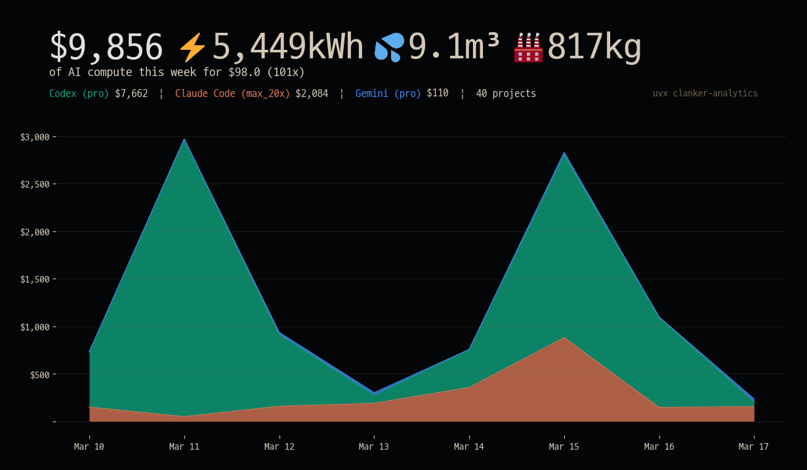
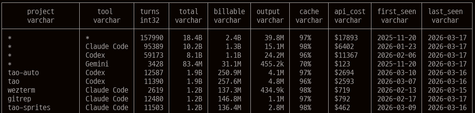
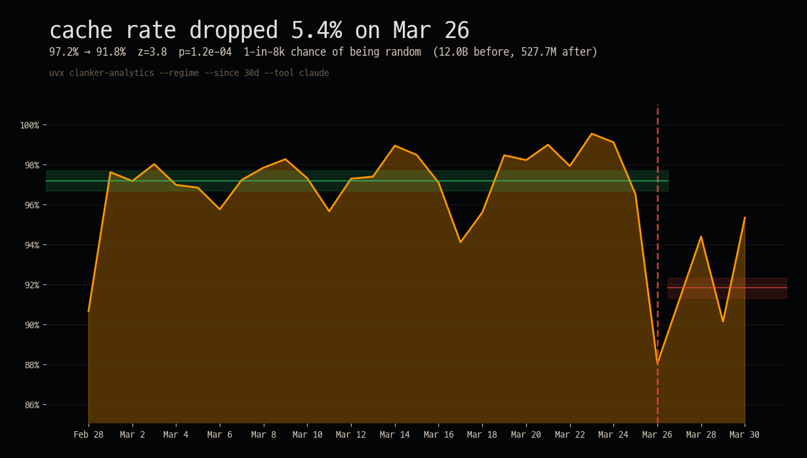

# clanker-analytics

Token usage analytics for AI coding tools. It reads local session logs and normalized runs from [Agent Orchestration Process (AOP)](https://github.com/wakamex/agent-orchestration-process), a tool for running bounded jobs across multiple agent CLI harnesses, then shows per-project breakdowns using DuckDB.

Supports Claude Code, Codex, Gemini CLI, Agy / Antigravity, Zcode, Muse Code, and every harness recorded by AOP.





Worried your cache hit rate dropped? `regime` auto-detects statistically significant changes using Welch's t-test: `clanker-analytics regime --since 30d --tool claude`

## Install

```
uv tool install clanker-analytics
```

Or run without installing:

```
uvx clanker-analytics
```

## Usage

Each view is a command. Without one, `clanker-analytics` runs `table`. Run `clanker-analytics COMMAND --help` for a command's options.

```
clanker-analytics                          # table of the last 7 days by project
clanker-analytics table --since 24h        # last 24 hours (also: 7d, 2w, 2026-03-01)
clanker-analytics table --by date          # grouped by date (also: model, session, execution)
clanker-analytics table --tool claude      # Claude Code only (also: codex, gemini, agy, aop, zcode, muse)
clanker-analytics chart                    # PNG bar chart of cost by tool per day over the last 7 days
clanker-analytics chart -o month.png       # save it elsewhere (also on share and regime)
clanker-analytics share                    # chart + copy to clipboard + open X
clanker-analytics regime                   # detect cache rate regime changes
clanker-analytics diagnose                 # what changed in the last 3 days vs the 7 before
clanker-analytics diagnose --since 2d --vs 5d    # choose both periods
clanker-analytics cache                    # prompt-cache health over the last 7 days
clanker-analytics throughput               # output tokens per second by day, with parallel streams
clanker-analytics record-quota             # retain current provider quota percentages
clanker-analytics pace                     # compare quota and local token pace at 1h, 6h, and 24h
clanker-analytics pace 5m 10m 15m          # arbitrary human-readable periods
clanker-analytics pace --json              # versioned machine-readable comparison
clanker-analytics pace --all-buckets       # include inactive quota buckets
clanker-analytics pace --model-mix         # include the model mix column
clanker-analytics quota-history            # implied full-quota API cost for every observed period
clanker-analytics value                    # API-equivalent value of each subscription vs its price
clanker-analytics value --plan codex=pro_500     # what-if with a different plan or price
clanker-analytics sql "SELECT ..."         # custom SQL against the 'tokens' table
clanker-analytics table --prices current   # reprice all usage at today's API rates
clanker-analytics table --refresh          # rebuild the cache first
clanker-analytics table --debug-timing     # print cache decisions and stage timings
clanker-analytics table --profile          # print a cProfile summary to stderr
```

The option-style form of version 0.4, such as `--table`, `--record-quota` or `--sql`, still runs, rewritten to the matching command with a deprecation warning, and will be removed in a later release.

## How it works

DuckDB reads session logs directly from `~/.claude/projects/`, `~/.codex/sessions/`, `~/.codex/archived_sessions/`, and
`~/.gemini/tmp/`, and per-request Zcode usage from `~/.zcode/cli/db/db.sqlite`. Gemini CLI chats are read from `${GEMINI_CLI_HOME:-~}/.gemini/tmp/*/chats/`, both the single-document `.json` chats it wrote until April 2026 and the JSON Lines `.jsonl` chats it writes since; a message Gemini CLI rewrites is appended again with the same id, and only its last line counts. Muse Code usage is read from `${XDG_DATA_HOME:-~/.local/share}/muse/sessions/YYYY/MM/DD/<session>/`, from the session's `session.jsonl` and each subagent's `subagent/<id>/session.jsonl`: each model call records a `model_completed` event with its model and usage, and an automated approval review records its usage once, as `automated_review_completed` in the session's log. A session's project is its `workspace_root`. Codex moves a conversation's log to `archived_sessions` when it is archived; the log keeps its file name, so a log read before and after the move is counted once. Claude Code transcripts are also read from the `projects/` directory of every other Claude Code home: `CLAUDE_CONFIG_DIR` when it is set, and each directory added to clanker-usage with `clanker-usage claude configure --config-dir`. It also reads AOP's archive of run results, `$XDG_STATE_HOME/aop/results/*.json` (default `~/.local/state/aop/results/`), which AOP 0.3.0 and later writes with every result, so a run's usage is found even after the project holding its `.aop` is deleted. Each AOP run is attributed to the directory that owns the `.aop` named in its `state_root`. Run `aop migrate-results` once to archive results written before 0.3.0. Results
are cached to `~/.cache/clanker-analytics/tokens.parquet` (ZSTD compressed) with a per-file manifest
at `~/.cache/clanker-analytics/tokens-meta.json`.

The cache is incremental: unchanged source files are reused and changed files are re-read. Claude Code and Codex logs only grow, so a changed one is read from where the last read stopped, after a hash of the bytes before that point confirms the log was not rewritten; a rewritten or truncated log is read again from its start. A Codex log's new lines are parsed together with the earlier lines its parser needs, such as the session header, the latest model, and the latest running token total, so they give the same rows as reading the whole log. A full rebuild only happens when the cache is missing, you pass `--refresh`, or the cache schema changes. The cache keeps the usage of source files it no longer finds, through updates and rebuilds alike, because tools prune their own logs and AOP runs get removed. The first cache write after a source file disappears reports how many files are no longer on disk. Deleting `tokens.parquet` therefore deletes that history; usage whose logs are gone cannot be recovered from the logs.

## Quota pace comparison

`record-quota` asks [clanker-usage](https://github.com/wakamex/clanker-usage) for fresh Claude, Codex, Antigravity, and Zcode quota
percentages and stores normalized snapshots in
`~/.local/state/clanker-analytics/quota.sqlite3`. The provider percentage remains authoritative and
includes activity that local session logs may miss. Claude, Antigravity, and Zcode history starts when the
recorder starts running.

clanker-usage prints one usage-v1 document per provider, through `python -m clanker_usage PROVIDER json`, and clanker-analytics reads every provider's the same way: each window becomes a bucket named by its length, such as `5h` or `1w`, prefixed by its model scope when it has one, and the document's `plan` becomes the detected plan when the reading is live or cached. The Claude account is the one `CLAUDE_CONFIG_DIR` selects, as in Claude Code. Snapshots recorded before a provider named its account are stored under `default`, and they move to the account a provider first names when it has never recorded another, so a window's history continues as one series. Earlier windows were renamed to the usage-v1 names for the same reason: Claude's `session`, `7d` and `7d_fable` to `5h`, `1w` and `Fable:1w`, Antigravity's to names such as `Gemini:5h` and `Claude and GPT:1w`, and Codex's `primary` and `secondary` slots to `5h`, `1w` or `30d` by their length. Claude snapshots were stored under the login's organization before clanker-usage 0.4.0, which names the account itself; `record-quota` moves a login's earlier snapshots and its email label to that account the first time it records the login.

Zcode quotas need `ZAI_API_KEY` configured for clanker-usage. When a provider's API is unavailable, clanker-usage returns its last cached reading, which keeps its original timestamp and so does not create a duplicate sample. Codex session logs also retain embedded historical quota observations.

`pace` compares the observed percentage-point change with local token activity over each requested
period. Local tokens are converted to API-equivalent dollars by model and cache category. An
experimental token-derived percentage-point rate is calibrated from local API-equivalent usage in
the current provider window and the latest quota percentage. This is a diagnostic comparison, not a
replacement for provider quota history. It will diverge when local logs are incomplete, another
client or person uses the account, or provider quota weighting differs from public API pricing.

For a fixed window, the report calculates the remaining target pace as remaining quota divided by
hours until reset. Each lookback then shows uncapped projected utilization at reset and direct
guidance. `slow N%` is the reduction needed to match the target, `headroom N%` means the observed
pace is below target, and rates within 10 percent of target say `on pace`. A nonzero provider
quota-delta rate is authoritative. The token-derived rate fills in only when the provider percentage
is flat, because short intervals can hide activity through quantization.

OpenAI reports a concrete reset timestamp, which the adapter uses as its forecast boundary. Official
OpenAI documentation does not currently establish the subscription quota's fixed-versus-rolling
semantics, so the JSON identifies this fallback as `reported_openai_reset`. The Antigravity 5h and
weekly buckets are treated as fixed reset windows. Retained 5h observations show utilization
accumulating under one stable reset timestamp and dropping all at once at that boundary. Lookbacks
never cross a fixed-window reset. Codex buckets are also classified as fixed from retained rollover
evidence. Claude personal plans (`ai`, Free, Pro, and Max) use fixed session and weekly windows;
included-usage Enterprise plans use rolling windows. Unrecognized Claude plan metadata remains
unknown, and usage-based Enterprise accounts do not expose a bounded percentage bucket. Rolling and
unknown windows do not receive target or workload-change guidance. When those buckets have a
complete lookback, the terminal report labels their percentage-point rate as a net trend and states
why projection is unavailable.

Below the lookbacks, a second table covers each account's current window of a day or longer, counting only the time that account was in use. `record-quota` records every Claude account clanker-usage has seen, from the document it keeps for each in `~/.cache/clanker-usage/claude/` (under `$XDG_CACHE_HOME` when set), besides the default login, so every account has snapshots whether or not it is in use. Use is therefore read from the quota itself: an account is in use over the stretches where any of its windows rose, with rises less than 30 minutes apart joined into one stretch so the flat readings between them count while usage stays inside one reported percentage point. `active h` is the hours of those stretches, `quota pp/h` the window's rise during them divided by those hours, and `vs even` compares it with using the whole window evenly, so `2.00x` on a weekly quota means the account would be used up in half a week of use. The account whose quota rose most recently is the one in use, and the lookbacks above pace only it against local usage. Other accounts stay in this table while their window is open and their quota rose during it, marked `last used` with the time of their last rise. Accounts are named by the local part of the login's email, which `record-quota` stores for the default Claude login, or by the start of the account key otherwise. `pace --json` carries the same figures as `window_pace` and `account_label` on each bucket, with accounts not in use under `inactive_buckets`.

The default periods are `1h`, `6h`, and `24h`. Pass any positive integer with `m`, `h`, `d`, or `w`
after the command, such as `pace 3h 7h`. Until enough snapshots have accumulated,
the corresponding row says `collecting history`.

The terminal report shows only complete lookbacks, meaning the selected historical sample covers
between 100 and 125 percent of the requested duration. Partial and still-collecting periods remain
available in `pace --json` but are omitted from the default table. If a displayed bucket has no
complete periods, such as under `--all-buckets`, it says `No complete lookbacks yet.`

Buckets with no quota movement and no matching local tokens across every completed requested period
are hidden by default. Use `--all-buckets` to inspect them. A nonzero bucket remains visible while
history is still being collected because its recent activity cannot yet be classified.

The terminal table omits model mix by default. Use `--model-mix` to add it. Model mix remains in
the JSON report regardless.

## Quota history audit

`quota-history` reconstructs every observed fixed quota period and estimates what a full quota is worth at API prices. Observations come from three places:

- Codex session files embed 7-day quota percentages in their token events.
- Zcode usage-limit errors are exact 100% observations of their window.
- The quota recorder database supplies Claude, Antigravity, and Zcode snapshots from `record-quota`.

For each period it uses the chronologically last nonzero quota observation, totals local token usage for that tool, including AOP runs of that tool, from the window start up to that observation, and reports:

- API-equivalent cost accumulated at the last observation.
- The implied full-quota API-equivalent cost, calculated as cost divided by used percentage.
- Change from the preceding estimate for the same tool, limit, and window length, cached-input share, model mix, and pricing flags.

Model-scoped buckets, such as Claude's per-model weekly limits or Antigravity's Gemini group, count only matching models. Reset timestamps are rounded to a five-minute anchor when grouping observations, because Codex emits slightly different reset timestamps into concurrent sessions and recorded snapshots can differ from log observations by a few seconds. Zero-percent fragments are skipped. AOP runs count toward the tool that executed them, at their start time, because they draw on the same subscription. An AOP run that neither model-prices nor AOP could price adds tokens but no cost and flags the period `unpriced_models`.

Claude quota snapshots record which login they came from, using the organization in Claude Code's `.claude.json`, so switching between two Claude logins keeps their quota periods apart. Snapshots recorded before this were all filed under one account; each is reassigned to a labeled login whose weekly quota resets at the same time of week, since every account keeps its own reset time, and the rest stay under `default`. A period's usage starts no earlier than the last snapshot of another login of the same tool, which marks the switch.

`value` summarizes what each subscription is worth at API prices. Each login of a tool is reported as its own subscription, named as in `pace`. For each tool it takes the latest weekly period from the quota history that is more than 15 percent used, since extrapolating a barely used week to a full quota is too noisy. Tools without such a week are omitted. It reports:

- The implied full-week and monthly API-equivalent value, using 365.25 / 12 / 7 weeks per month.
- The monthly plan price and the value as a multiple of it.
- API-equivalent and effective dollars per million tokens, from that week's own mix of input, cache, and output tokens. The effective price is the API price divided by the multiple.

The plan comes from clanker-usage, as for the chart, and its monthly price from model-prices. Plans whose reported name covers several prices, such as Google AI Ultra's two tiers, are unpriced, and ChatGPT Pro is priced at $200 although Codex reports its $100 and $500 tiers the same way. A stale cached reading does not count as a current plan. Antigravity uses the Google AI plan reported for Gemini.

A week is priced at the plan it ran on. Codex logs name the plan beside each weekly quota reading, and `record-quota` stores the plan with each Claude snapshot, so a week keeps its plan and that plan's price after you upgrade or downgrade. A configured or detected plan that is a tier of the reported one, such as `pro_200` for a week Codex reported as `pro`, is used as the more exact name. Weeks whose readings name no plan, including Claude snapshots recorded before 0.5.1, use the current plan. `--plan` applies to every week.

When detection cannot tell your plan, name it once in `~/.config/clanker-analytics/config.toml`, either as an model-prices plan id or as a monthly price:

```toml
[plans]
codex = "pro_200"
gemini = "ultra_200"
zcode = 18
```

The keys are `claude`, `codex`, `gemini`, and `zcode`. An unknown plan id is an error that lists the valid ids. `--plan TOOL=PLAN|USD`, repeatable, overrides the file for one run, such as `--plan codex=pro_500` for a what-if. Plan settings apply wherever plan prices are shown, including the chart.

For Codex, the report also removes inherited `token_count` events replayed into newly forked sessions. Without
that removal, local usage can be counted again every time a session is forked.
Codex timestamps are read as their original UTC strings instead of relying on JSON type inference;
otherwise timezone-less coercion can move activity across quota boundaries on non-UTC hosts.

Periods are priced at the rates in effect when each request ran; the line above the table names the model-prices data and pricing basis. With `--prices current`, every period uses today's rates, so API price changes do not look like quota changes. Periods with usage that could not be priced show `unpriced_models`, periods priced partly from AOP's recorded costs show `aop_recorded_pricing`, and non-default rate modes show
`unsupported_rate_mode`. Estimates extrapolate from the used percentage, so low-usage periods are
rough.

The report reads the incremental Parquet cache. The first run may need one full source-file rebuild;
later runs update only changed files and query the complete history in one DuckDB aggregation. Codex
logs do not expose a stable account identifier, so users who switched or concurrently used multiple
accounts should not treat the combined result as account-specific.

To record every five minutes with a systemd user timer:

```sh
mkdir -p ~/.config/systemd/user
cp systemd/clanker-analytics-quota.* ~/.config/systemd/user/
systemctl --user daemon-reload
systemctl --user enable --now clanker-analytics-quota.timer
```

The included service expects the executable at `~/.local/bin/clanker-analytics`, which is where
`uv tool install clanker-analytics` installs it by default.

`--debug-timing` prints cache decisions and per-stage timings. `--profile` adds a Python `cProfile` summary; it is mainly useful for filesystem scanning and Python-side overhead, not DuckDB query execution time.

## Diagnosing a jump in usage

`diagnose` compares the `--since` period (default 3 days) with the `--vs` period before it (default 7 days), per day so periods of different length compare. It reports API-equivalent cost, output tokens, cost per million output tokens, requests, the share of prompt tokens read from cache, cache writes, and cold starts, then breaks the change in cost down by tool, project, thread (main conversation or subagent), session, and token type, largest first.

`cache` reports how well prompt caching worked over `--since` (default 7 days), by tool and thread and for the sessions whose cache misses cost most:

- Read from cache: the share of prompt tokens served from the cache.
- Discount: what caching saved on prompt tokens compared with sending them uncached, next to the best a fully warm cache could achieve. Each model's own cache price sets the best case, such as 95% off for Claude Opus 5.5 and 90% for most others.
- Miss cost: what was paid beyond a fully warm cache.
- 1h writes: the share of cache writes that went to Anthropic's one-hour cache, which Claude Code uses for the main conversation; subagents use the five-minute cache unless `subagentPromptCacheTtl` is set.
- Reads per write: how many times each cached token was read. A five-minute write pays off after one read and a one-hour write after two.
- Cold starts: requests that wrote nearly their whole prompt to the cache, split into a transcript's first request, those that came after idling longer than the cache lifetime, and the rest, with the cost of the ones after idling.

It ends with an estimate of what Claude Code subagents would have paid for prompt tokens on the one-hour cache, which turns their cold starts after five minutes to an hour of idling into cache reads at a higher write price.

`throughput` reports, for each UTC day of `--since` (default 7 days), the output tokens and output tokens per second averaged over the whole day including idle time, the busiest hour's rate, the hours with any output, and how many transcripts (main conversations or subagents) made requests in the same hour: the median over active hours and the peak. It shows whether parallel agents added output or mostly waited. AOP runs are recorded as one summary at completion, so they are counted as finished runs rather than streams.

## Columns

- `total` - all tokens processed (input + output + cache write + cache read)
- `billable` - total minus the 90% cache read discount
- `output` - output tokens only
- `cache` - cache read hits as a percentage of input tokens
- `api_cost` - estimated cost at API rates
- `count_basis` - `exact` or `processed estimate`
- `retained_text` - unique retained transcript text estimated at four characters per token when the
  source supports it
- `execution_type` - `interactive`, `exec`, `subagent`, or `unknown`; available through
  `table --by execution` and the `sql` command. Sessions under `/.aop/worktrees/` count as subagents even when
  launched through a headless execution.
- `project` - the project's directory name. A Claude Code session's requests all take the name of the directory it was launched in, including requests made in a subdirectory or another repository. AOP runs take the repository that owns `.aop`.
- `project_path` - exact working directory when the source log provides it
- `token_count_type` - `exact` when the source retained complete API token metadata, otherwise
  `estimated_processed`
- `turn_count` - model or API turns represented by the row
- `retained_tokens` - the unique retained transcript text estimate before repeated model context is
  counted; available through custom SQL
- `source_kind` - `native` for provider session logs or `aop` for normalized AOP run results
- `cost_usd` - the AOP-recorded API-equivalent cost when AOP retained one; native rows remain null
- `timestamp` - provider event timestamp used for sub-day quota comparisons
- `rate_mode` - active provider rate or service mode when the source records it

For Agy, discovery reads canonical logs at
`~/.gemini/antigravity-cli/brain/*/.system_generated/logs/transcript_full.jsonl` and uses
`cache/conversation_metadata.json` to select top-level conversations and obtain their workspace
roots. Compact copies, chunk mirrors, internal trajectories, duplicate events, and resumed
`CONVERSATION_HISTORY` entries are not counted.

Antigravity transcripts do not name the model. Each session's model comes from its conversation database, `conversations/<session>.db`, whose generation metadata records every model call. Most records name the model the user selected, such as `Gemini 3.5 Flash (High)`, which is stored in Antigravity's slug form `gemini-3.5-flash-high`. Sessions whose records lack that name use the last model selection noted in the conversation, then the serving model name. Serving names can be aliases: `gemini-default` and `gemini-3-flash-a` both ran Gemini 3.5 Flash (High) in July and August 2026.

The same generation metadata records each model call's usage, which Agy reports exactly: one row per call, with uncached input, cache reads and output including thinking, timed by the transcript step the call ended on. On one 2,524-call session this gives 386 million tokens, 95% of them cache reads, where the transcript estimate below gave over 5 billion uncached input tokens, because it charges every response the whole transcript so far while Antigravity keeps the context under its 256,000-token window and serves most of it from cache.

When complete API usage metadata is retained in the transcript for a model turn, those counters are reported exactly.
Otherwise, for sessions without a conversation database, Agy reports a processed-token estimate. Each completed `PLANNER_RESPONSE` is a model turn,
its output is estimated from that response, and its input is estimated from the cumulative retained
context preceding it. Tool results such as `RUN_COMMAND` and `VIEW_FILE` are input to a later model
turn, not model output. `retained_tokens` counts the same retained text once so it is directly
distinguishable from repeated processed context. Hidden system prompts, media tokenization, and
unrecorded context truncation cannot be reconstructed. Share cards mark processed estimates with `~`
and a `processed estimate` tool label.

For Zcode, each row is one model request from the `model_usage` table, including compaction and subagent requests. Zcode reports input with cache reads and writes included, so `input_tokens` holds the uncached remainder. Sessions with a parent session are `subagent` rows. Models are named `zai/<model>` to match AOP's Zcode results, and AOP's `zcode` provider is reported as the same `Zcode` tool. The cache manifest tracks the database together with its write-ahead log, because SQLite commits new requests to the log first. A request rejected with a Z.ai usage-limit message, such as `Usage limit reached for 5 hour. Your limit will reset at 2026-09-28 03:11:57`, becomes a zero-token row carrying an exact 100% quota observation in the `quota_*` columns. Z.ai writes these reset times in China Standard Time (UTC+8); each observed reset falls exactly one window after the request that opened it.

For AOP records, each `aop-token-usage-v3` result with complete or usage-bearing partial accounting contributes that run's own usage. Results with unavailable accounting are omitted. Input and output are totals, while cached input and reasoning output are subsets that are not added again. AOP converts older records to v3 with `aop migrate-results` and documents the format in `docs/token-usage.md`. A result in any other format is not read: its previously cached usage is kept, and each run prints a warning to run `aop migrate-results`. Invalid accounting statuses are rejected. Resumed runs remain separate deltas under one session and are summed. Overlapping Claude Code, Codex, and Agy native session rows are suppressed so the same work is not counted twice. AOP rows are attributed to the repository that owns `.aop`, use a synthetic path under that repository's `.aop/worktrees/` directory, and have `execution_type = 'subagent'`. `turn_count` is the number of retained AOP invocations because the normalized result does not retain a portable count of internal model turns.

## API cost calculation

Every row is priced with [model-prices](https://github.com/wakamex/model-prices), which records each model's API price history from models.dev with sourced corrections and time-of-day schedules. A row is priced at the rates in effect when its request ran: GPT-5.6 Sol usage before August 22, 2026 costs $5/$30 per million input/output tokens, and after it $4/$20. DeepSeek requests during its peak hours cost twice the off-peak rate. Long-context tiers apply per request, so several shorter requests never reach a tier together.

`--prices current` reprices every request from today's price list instead, while keeping each request's own peak or off-peak hour. Use it to compare usage across periods without price changes showing up as usage changes.

Prices are computed once per row when the cache is built, into `api_cost_usd` (rates when the request ran) and `current_api_cost_usd` (today's rates). Each report run fetches model-prices' newest published price data when the local copy is more than a day old; offline, it keeps the local copy and warns. The cache records the data version and reprices every row when it changes. The `table`, `diagnose`, `cache`, `quota-history` and `value` reports end with a `pricing:` line naming that version, so a cost can be traced to the exact price data behind it. The `pricing` column says where each row's price came from:

- `model-prices`: priced from the model's API price history.
- `assumed model`: an AOP run that recorded no model and has no native log of its own. It is priced as the model its tool ran most that day.
- `aop`: an AOP run whose model model-prices cannot price, which keeps the API-equivalent cost AOP recorded.
- `unpriced`: no price is known, such as Codex's internal `codex-auto-review`. These rows count as zero in cost totals.

The `billable` token column applies the same cache discount across sources. These estimates represent API-equivalent usage, not subscription charges.

## Environmental impact estimates

The `chart` and `share` output shows estimated environmental impact per million tokens:

| Metric | Per 1M tokens | Source |
|---|---|---|
| Electricity | 0.6 kWh | [Epoch AI](https://epoch.ai/gradient-updates/how-much-energy-does-chatgpt-use), [arxiv:2505.09598](https://arxiv.org/abs/2505.09598) |
| Water | 1 liter | [Li & Ren (2023)](https://cacm.acm.org/sustainability-and-computing/making-ai-less-thirsty/), adjusted for modern models |
| CO2 | 90 g | [Ritchie (2025)](https://hannahritchie.substack.com/p/ai-footprint-august-2025) |

These are rough estimates - actual impact varies 10-100x depending on model, hardware, and data center location. No provider publishes official per-token figures.

## Chart colors

Brand colors used in `chart` and `share` output:

| Tool | Color | Source |
|---|---|---|
| Claude Code | `#d97757` | [Anthropic brand guidelines](https://github.com/anthropics/skills/blob/main/skills/brand-guidelines/SKILL.md) |
| Codex | `#10a37f` | [OpenAI brand](https://openai.com) |
| Gemini | `#4285f4` | [Google brand](https://about.google/brand-resource-center/) |
| Agy | `#a142f4` | Distinct Antigravity session color |

## Requirements

Python 3.13+, DuckDB 1.5+, matplotlib 3.9+, model-prices 0.0.2+.

Tested on Linux, macOS, and Windows (including WSL data auto-discovery).

## Development

```bash
uv run --locked python -m unittest discover -s tests
```

## License

The code is MIT licensed, in [LICENSE](LICENSE). The bundled Clanker Mono font is a modified version of D2Coding, copyright (c) 2015 NAVER Corporation, licensed under the SIL Open Font License 1.1 in `src/clanker_analytics/OFL-ClankerMono.txt`. The emoji images in `src/clanker_analytics/emoji/` are [Twemoji](https://github.com/jdecked/twemoji) graphics, copyright Twitter, Inc. and other contributors, licensed under [CC-BY 4.0](https://creativecommons.org/licenses/by/4.0/) in `src/clanker_analytics/emoji/LICENSE-CC-BY-4.0.txt`.
